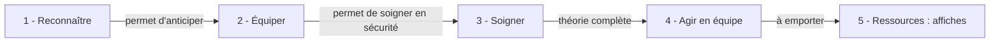
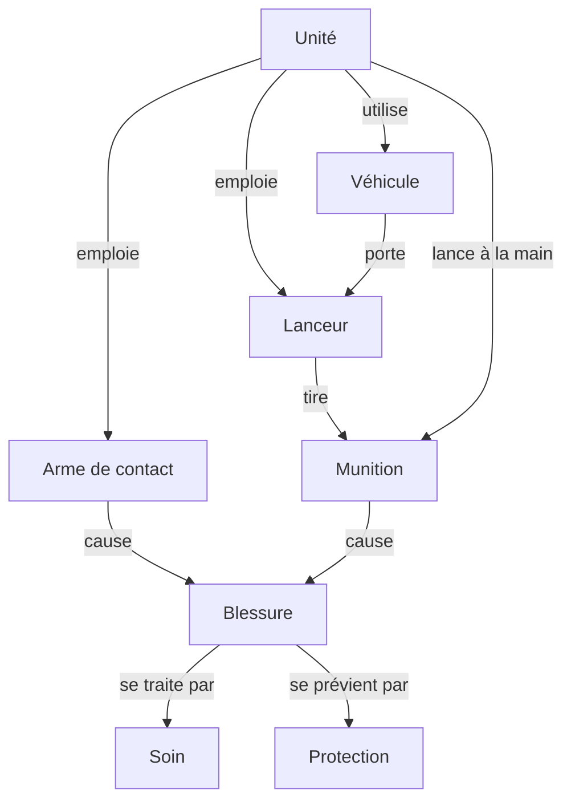

# Pourquoi cet ordre
Connaître à l'avance les moyens employés permet de savoir comment s'équiper pour soigner en sécurité. Une fois la théorie acquise, on peut apprendre à se coordonner en équipe.

1. Reconnaître : identifier les moyens employés.
2. Équiper : choisir la protection adaptée.
3. Soigner : savoir quoi faire selon la gravité.
4. Agir : coordonner l'équipe avant, pendant, après.
5. Ressources : emporter les affiches imprimables.
# Carte des liens
Comment les unités, les armes, les munitions et les véhicules se relient aux blessures.

